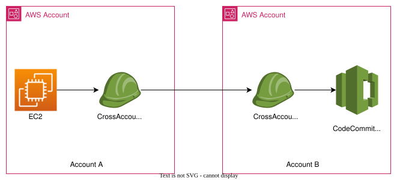

You can configure access to CodeCommit repositories for IAM Role attached to an EC2 Instance in another AWS account. This is often referred to as cross-account access. This section provides an example and instructions for configuring cross-account access for a repo named `SharedDemoRepo` in the US East (Ohio) Region in an AWS account (referred to as AccountA) to an IAM Role/Instance Profile attached to an EC2 Instance in another AWS account (referred to as AccountB).

This section is divided into three parts:
- Part 1: Actions for the IAM Role in AccountA
- Part 2: Actions for the IAM Role in AccountB
- Part 3: Configuration on EC2 Instance in AccountB



___
### Part 1: Actions for the IAM Role in AccountA
To allow IAM Roles in AccountB to access a repository in AccountA, an AccountA administrator must:
- Create a policy in AccountA that grants access to the repository.
- Create a role in AccountA that can be assumed by IAM Role in AccountB.
- Attach the policy to the role. 

The following sections provide steps and examples.

#### Step 1: Create a policy for repo `SharedDemoRepo` access in AccountA
```
{
    "Version": "2012-10-17",
    "Statement": [
        {
            "Effect": "Allow",
            "Action": [
                "codecommit:BatchGet*",
                "codecommit:Create*",
                "codecommit:DeleteBranch",
                "codecommit:Get*",
                "codecommit:List*",
                "codecommit:Describe*",
                "codecommit:Put*",
                "codecommit:Post*",
                "codecommit:Merge*",
                "codecommit:Test*",
                "codecommit:Update*",
                "codecommit:GitPull",
                "codecommit:GitPush"
            ],
            "Resource": [
                "arn:aws:codecommit:us-east-2:${ACCOUNTA_ID}:SharedDemoRepo"
            ]
        },
        {
            "Effect": "Allow",
            "Action": "codecommit:ListRepositories",
            "Resource": "*"
        }
    ]
}
```

#### Step 2: Create a role for repo access in AccountA
Create a new Role `CrossAccountRepoAccessRole` and attach the above policy to that role. 

___
### Part 2: Actions for the IAM Role in AccountB
To allow an EC2 Instance in AccountB to access a repository in AccountA, the AccountB administrator must create an IAM Role that can be attached to an EC2 Instance in AccountB. This role must be configured with a policy that allows the EC2 Instance to assume the role created in the AccountA. 

The following sections provide steps and examples.

#### Step 1: Create a policy for repo access in AccountB
```
{
  "Version": "2012-10-17",
  "Statement": {
    "Effect": "Allow",
    "Action": "sts:AssumeRole",
    "Resource": "arn:aws:iam::${ACCOUNTA_ID}:role/CrossAccountRepoAccessRole"
  }
}
```

#### Step 2: Create a role for an AWS Service "EC2"
Create a new Role `CrossAccountRepoAccessRole` for an AWS Service "EC2" (it will create the following trust relationship for the role to be assumed from an EC2 Instance) and attach the above policy to that role. 

```
{
    "Version": "2012-10-17",
    "Statement": [
        {
            "Effect": "Allow",
            "Principal": {
                "Service": "ec2.amazonaws.com"
            },
            "Action": "sts:AssumeRole"
        }
    ]
}
```
___
### Part 3: Configuration on EC2 Instance in AccountB
To access the repositories in AccountA, users in the AccountB must configure the EC2 Instance for repositories access. The following sections provide steps and examples.

> Prerequisite: Please make sure the `AWS CLI` and `git` packages are installed.

#### Step 1: Configure the AWS CLI and Git for an AccountB EC2 Instance to access the repositories in AccountA

You need to configure the AWS CLI either by using the `aws configure --profile` command or editing the `~/.aws/config` file. 

```
[profile cross-account-role]
role_arn = arn:aws:iam::${ACCOUNTA_ID}:role/CrossAccountRepoAccessRole
credential_source = Ec2InstanceMetadata
region = us-east-2
```

To confirm that you've set your permissions correctly, run:

```
aws codecommit --profile cross-account-role get-repository --repository-name ${REPO_NAME_IN_ACCOUNTA}
```
Once above is successful, you can configure the git client to use the credential-helper with the correct profile, in your ~/.gitconfig by running:

```
git config --global credential.helper '!aws codecommit --profile '"$PROFILE_NAME"' credential-helper $@'
git config --global credential.UseHttpPath true
```

```
git clone --branch ${BRANCH_NAME} ${REPO_CLONE_URL_IN_ACCOUNTA}
```

## Conclusion
You can keep your code in CodeCommit Repositories in a central AWS Account and access it from different AWS Accounts using the IAM Roles. Please don't forget to follow the principle of least privileges while configuring above policies in Production environments.

Hope you find this post helpful.

___
## References
- [Configure cross-account access to an AWS CodeCommit repository using roles](https://docs.aws.amazon.com/codecommit/latest/userguide/cross-account.html)
- [Installing or updating the latest version of the AWS CLI](https://docs.aws.amazon.com/cli/latest/userguide/getting-started-install.html)