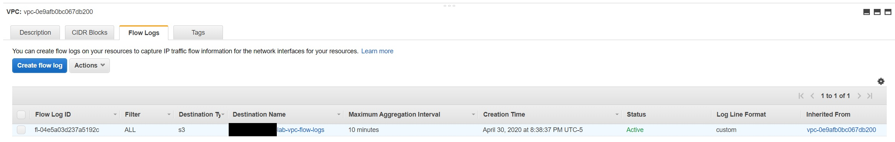
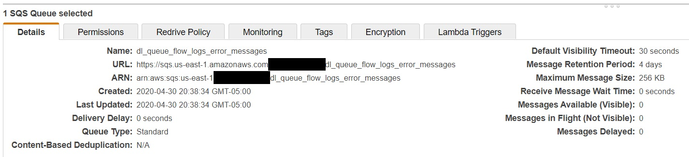
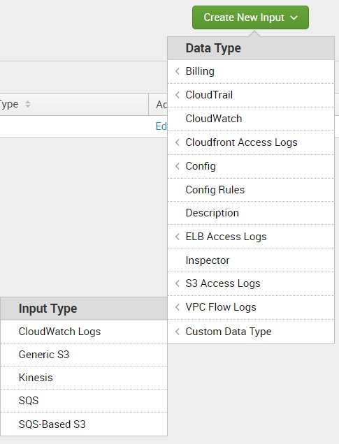
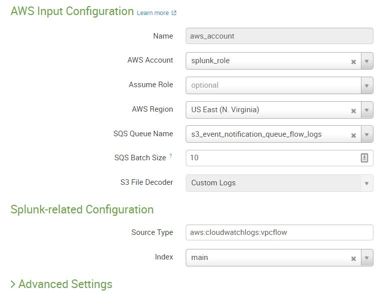

In this blog post, we will learn how to ingest VPC flow logs with additional metadata into Splunk. We will start by creating a VPC flow log using Terraform and pushing the logs to S3. From S3, we will ingest these logs into Splunk using SQS. Finally, we will make some changes to Splunk's `props.conf` file for correct field extraction of the additional VPC flow log fields.  


All Terraform files are available to download at my [GitHub Repo](https://github.com/harwinds/logsec_blog_code). You just need to edit the `terraform.tfvars` file and put your AWS `ACCESS KEY ID` and `SECRET ACCESS KEY`.

```shell
maven@pluto:~$ tree ./terraform/
./terraform/
├── cloudtrail.tf
├── module.tf
├── output.tf
├── provider.tf
├── splunk
│   ├── instance_splunk.tf
│   ├── splunk_iam_role.tf
│   ├── splunk_iam_role_pol.json
│   ├── user_data_splunk.sh
│   ├── sqs_vpc_flow_logs.tf
│   ├── variables.tf
│   ├── vpc_flow_log.tf
│   └── vpc_splunk.tf
├── sqs_cloudtrail_logs.tf
├── terraform.tfvars
├── variables.tf
└── versions.tf
```

In our [previous post](/posts/ingest-cloudtrail-logs-to-splunk/), we set up a Splunk environment on AWS using Splunk Enterprise. For today's task, we add two Terraform files, `vpc_flow_log.tf` and `sqs_vpc_flow_logs.tf`, to that existing infrastructure.

### Create a VPC Flow log for the existing Splunk VPC
[VPC Flow Logs](https://docs.aws.amazon.com/vpc/latest/userguide/flow-logs.html) is a feature that enables you to capture information about the IP traffic going to and from network interfaces in your VPC.

Default VPC Flow Log format
```
<version> <account-id> <interface-id> <srcaddr> <dstaddr> <srcport> <dstport> <protocol> <packets> <bytes> <start> <end> <action> <log-status>
```

But we will be creating a custom format for the flow log record using additional metadata fields. This lets us create flow logs that are specific to our needs; you can add or omit fields based on your requirements. We will be adding all the available fields for this demo. Additional fields like `instance-id` make an analyst's life much easier when finding the actual source during an investigation, instead of relying only on `srcaddr`. Because EC2 instances are ephemeral, a private IP address can later be assigned to a different instance.

```
<version> <vpc-id> <subnet-id> <instance-id> <interface-id> <account-id> <type> <srcaddr> <dstaddr> <srcport> <dstport> <pkt-srcaddr> <pkt-dstaddr> <protocol> <bytes> <packets> <start> <end> <action> <tcp-flags> <log-status>
```

```terraform
# Flow Logs for the Splunk VPC
resource "aws_flow_log" "splunk_vpc_flow_log" {
  log_destination          = aws_s3_bucket.flow_log_bucket.arn
  log_destination_type     = "s3"
  traffic_type             = "ALL"
  vpc_id                   = aws_vpc.splunk_vpc.id
  log_format               = "$${version} $${vpc-id} $${subnet-id} $${instance-id} $${interface-id} $${account-id} $${type} $${srcaddr} $${dstaddr} $${srcport} $${dstport} $${pkt-srcaddr} $${pkt-dstaddr} $${protocol} $${bytes} $${packets} $${start} $${end} $${action} $${tcp-flags} $${log-status}"
  max_aggregation_interval = "600"
}
```
> Please note, a resource-based policy will be created for you and attached to the target bucket.



### Create an Amazon S3 bucket for our VPC Flow Logs.
```terraform
# S3 bucket for VPC Flow logs
resource "aws_s3_bucket" "flow_log_bucket" {
  bucket = "${var.account_id}-lab-vpc-flow-logs"
}

output "splunk_vpc_log_id" {
  description = "The Flow Log ID"
  value       = aws_flow_log.splunk_vpc_flow_log.id
}
```

### Create two SQS Queues.
Now it's time to create the SQS queues. Two queues will be required. One queue will be the dead letter queue for error messages to be kicked over to and the other will be the queue used to capture the S3 notifications when a new VPC Flow Log event is sent to the S3 bucket we created in earlier step.

```terraform
# Add Amazon S3 Event Notification configuration to SQS Queue
resource "aws_sqs_queue" "queue_flow_logs" {
  name                       = "s3_event_notification_queue_flow_logs"
  visibility_timeout_seconds = 300
  redrive_policy = jsonencode({
    deadLetterTargetArn = aws_sqs_queue.dl_queue_flow_logs.arn
    maxReceiveCount     = 1
  })

  policy = <<POLICY
{
  "Version": "2012-10-17",
  "Statement": [
    {
      "Effect": "Allow",
      "Principal": "*",
      "Action": "sqs:SendMessage",
      "Resource": "arn:aws:sqs:*:*:s3_event_notification_queue_flow_logs",
      "Condition": {
        "ArnEquals": { "aws:SourceArn": "${aws_s3_bucket.flow_log_bucket.arn}" }
      }
    }
  ]
}
POLICY
}

# Set up a dead-letter queue for the SQS queue to be used for the input for storing invalid messages
resource "aws_sqs_queue" "dl_queue_flow_logs" {
  name = "dl_queue_flow_logs_error_messages"
}

resource "aws_s3_bucket_notification" "bucket_notification" {
  bucket = aws_s3_bucket.flow_log_bucket.id

  queue {
    queue_arn = aws_sqs_queue.queue_flow_logs.arn
    events    = ["s3:ObjectCreated:*"]
  }
}

output "sqs_arn" {
  description = "The ARN of the SQS queue"
  value       = aws_sqs_queue.queue_flow_logs.arn
}
```



### Configure Splunk Add-on for VPC Flow logs 
In our previous post, we already set up the Splunk environment by installing these two apps.
- [Splunk Add-on for Amazon Web Services](https://splunkbase.splunk.com/app/1876/)
- [Splunk App for AWS](https://splunkbase.splunk.com/app/1274/)

If you haven't already done so, please follow steps 8-13 in the [previous post](/posts/ingest-cloudtrail-logs-to-splunk/).

In the Splunk Add-on for AWS, go to the "Inputs" tab and create a new input with Data Type **VPC Flow Logs** and Input Type **SQS-Based S3**:



Select the flow logs event notification queue and set the source type to `aws:cloudwatchlogs:vpcflow`:



Next, we need to update the `props.conf` file on the Splunk Search Head for the AWS Add-on app. It is located at `$SPLUNK_HOME/etc/apps/SPLUNK_TA_aws/default/props.conf`.

> Tip: Splunk recommends putting your changes in `local/props.conf` instead of `default/props.conf`, so they survive add-on upgrades.

> Before

```conf
##################################
###    AWS CloudWatch Logs     ###
##################################

[aws:cloudwatchlogs:vpcflow]
SHOULD_LINEMERGE = false
EXTRACT-all=^\s*(\d{4}-\d{2}-\d{2}.\d{2}:\d{2}:\d{2}[.\d\w]*)?\s*(?P<version>[^\s]+)\s+(?P<account_id>[^\s]+)\s+(?P<interface_id>[^\s]+)\s+(?P<src_ip>[^\s]+)\s+(?P<dest_ip>[^\s]+)\s+(?P<src_port>[^\s]+)\s+(?P<dest_port>[^\s]+)\s+(?P<protocol_code>[^\s]+)\s+(?P<packets>[^\s]+)\s+(?P<bytes>[^\s]+)\s+(?P<start_time>[^\s]+)\s+(?P<end_time>[^\s]+)\s+(?P<vpcflow_action>[^\s]+)\s+(?P<log_status>[^\s]+)
```
> After

```conf
##################################
###    AWS CloudWatch Logs     ###
##################################

[aws:cloudwatchlogs:vpcflow]
SHOULD_LINEMERGE = false
EXTRACT-all=^\s*(\d{4}-\d{2}-\d{2}.\d{2}:\d{2}:\d{2}[.\d\w]*)?\s*(?P<version>[^\s]+)\s+(?P<vpc_id>[^\s]+)\s+(?P<subnet_id>[^\s]+)\s+(?P<instance_id>[^\s]+)\s+(?P<interface_id>[^\s]+)\s+(?P<account_id>[^\s]+)\s+(?P<type>[^\s]+)\s+(?P<src_ip>[^\s]+)\s+(?P<dest_ip>[^\s]+)\s+(?P<src_port>[^\s]+)\s+(?P<dest_port>[^\s]+)\s+(?P<pkt_srcaddr>[^\s]+)\s+(?P<pkt_dstaddr>[^\s]+)\s+(?P<protocol_code>[^\s]+)\s+(?P<bytes>[^\s]+)\s+(?P<packets>[^\s]+)\s+(?P<start_time>[^\s]+)\s+(?P<end_time>[^\s]+)\s+(?P<vpcflow_action>[^\s]+)\s+(?P<tcp_flags>[^\s]+)\s+(?P<log_status>[^\s]+)
```

### Search the VPC Flow Logs in Splunk
Log in to the Splunk instance using the public IP of the EC2 instance and search for the flow logs using the SPL:
```
index=main sourcetype=aws:cloudwatchlogs:vpcflow 
| table version vpc_id subnet_id instance_id interface_id account_id type src_ip dest_ip src_port dest_port pkt_srcaddr pkt_dstaddr protocol_code bytes  
 packets start_time end_time vpcflow_action tcp_flags log_status
```
___
**Summary**: In this post, we ingested custom VPC flow logs into Splunk and configured the Splunk TA to correctly parse those logs. Questions and suggestions are welcome. Happy Learning.

***

## References
- <https://docs.splunk.com/Documentation/Splunk/latest/Security/Secureyouradminaccount#Create_admin_credentials_after_starting_Splunk_Enterprise>
- <https://docs.splunk.com/Documentation/AddOns/released/AWS/Setuptheadd-on>