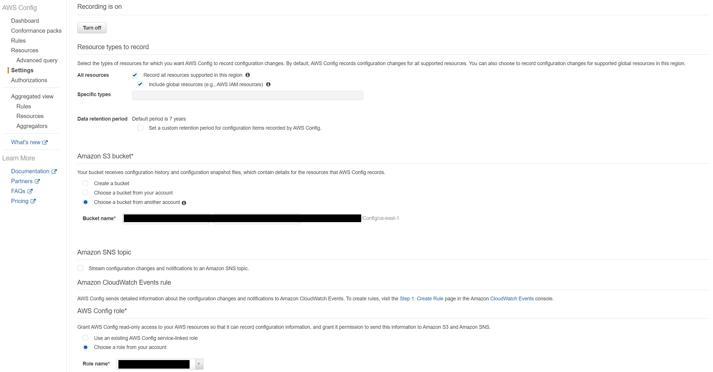
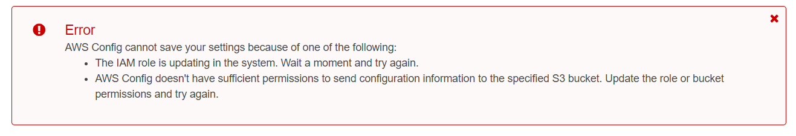
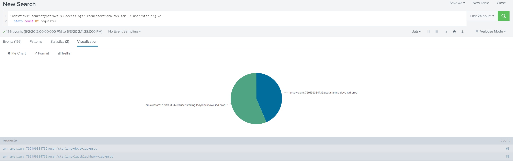

During the past week, we detected some suspicious activities across multiple AWS accounts in one of our clients' environments. These activities seemed related to S3 bucket scanning by a bad actor. Here is one of the sample logs from the S3 access logs:
```
84fd7086179626a759fb59a0252a26d26dc1685e30f0ab922266b5abace8f998 <AWS-ACCOUNT-ID>-config-org-bucket [01/Jun/2020:13:27:34 +0000]  
10.247.13.187 arn:aws:iam::799199334739:user/starling-ladyblackhawk-iad-prod 9WDX6MBZFQ6Z6RDR REST.HEAD.BUCKET  
- "HEAD / HTTP/1.1" 403 AccessDenied 243 - 9 - "-" "AWSConfig" - wFvPfIaSbdpcnNMdcTj+BNWn00r3OfqHV8sTt8gUXMzLA7O/MiWg+NPckix2TThK15V/p1JigVc=  
SigV4 ECDHE-RSA-AES128-SHA AuthHeader <AWS-ACCOUNT-ID>-config-org-bucket.s3.amazonaws.com TLSv1.2
```

The first thing that caught our attention in this log was the username `starling-ladyblackhawk-iad-prod`. The question to ask at this stage: is this a rogue IAM user? We do not follow such a naming convention across the organization. Second, the AWS account ID `799199334739` does not belong to us. So this is definitely not a rogue user in our environment. 

Next, we extended the time range in Splunk and used the search below to look for an `http_status` other than 403. Fortunately, there were no 200s, but these activities had been continuous for the last couple of months. 

```
index="aws" sourcetype="aws:s3:accesslogs"
| table error_code http_status operation bucket_name remote_ip requester request_uri user_agent index
```

Another interesting thing to notice in the S3 access logs is that the `user agent` is `AWSConfig` and the remote IP is private. When we access an S3 bucket using the AWS CLI, the remote IP is the public IP of the user's machine. But in this case, it was private. To gather more information about this behavior, see the [S3 access logs format](https://docs.aws.amazon.com/AmazonS3/latest/dev/LogFormat.html "AWS Documentation"). As per the AWS documentation:

> Remote IP: The apparent internet address of the requester. Intermediate proxies and firewalls might obscure the actual address of the machine making the request.

The next step was to determine the reason behind the AWS Config user agent. Is this a misconfiguration in someone's AWS account, someone manipulating the user agent, or maybe even someone using AWS Config for these scanning activities? To answer these questions, I tried to replicate the same behavior using AWS Config in our learning environment.

In Account A, we created two S3 buckets named **`AWS-ACCOUNT-ID`-config-org-bucket** and **`AWS-ACCOUNT-ID`-s3-access-logs**. We turned on `Server access logging` for the first bucket and selected the second bucket as the target. The Block Public Access flag is enabled at the account level to ensure that public access to all S3 buckets and objects is blocked. Refer to [Using Amazon S3 block public access](https://docs.aws.amazon.com/AmazonS3/latest/dev/access-control-block-public-access.html "AWS Documentation").

In Account B, we turned on recording under Settings for AWS Config, as shown in the screenshot below. It works when we select an S3 bucket that exists and has the proper permissions. You can look up the correct permissions at [S3 bucket policy](https://docs.aws.amazon.com/config/latest/developerguide/s3-bucket-policy.html "AWS Documentation").



But when we attempt to select the bucket **`AWS-ACCOUNT-ID`-config-org-bucket** from Account A, which either does not exist or does not have the correct bucket policy, it throws an error:



Next, we logged in to Splunk to investigate the S3 access logs for **`AWS-ACCOUNT-ID`-s3-access-logs** in Account A. Using the same search as earlier, we found a similar pattern in the S3 access logs:

```
84fd7086179626a759fb59a0252a26d26dc1685e30f0ab922266b5abace8f998 <AWS-ACCOUNT-ID>-config-org-bucket [03/Jun/2020:03:12:08 +0000]  
10.247.239.161 arn:aws:sts::xxxxxxxxxxxx:assumed-role/account/AWSConfig-Describe 944A6758900290DD  
REST.GET.ACCELERATE - "GET /?accelerate HTTP/1.1" 200 - 113 - 10 - "-" "AWSConfig" -  
joUWdNULBFcczofcQ4HDKGOMGCSy4mCVeAh/oc66yuelKFYnazB6dftz2d6c91GXfZRqtNNmXCc= SigV4  
ECDHE-RSA-AES128-SHA AuthHeader <AWS-ACCOUNT-ID>-config-org-bucket.s3.us-east-1.amazonaws.com TLSv1.2
```
As this log is similar to what we saw in the client's environment, we can be sure that either someone misconfigured their AWS Config `Amazon S3 Bucket` setting to write their logs to our bucket, or someone is using this to determine whether a particular S3 bucket exists. We are now also confident about the AWS Config user agent, and that the remote IP is a private IP based on the VPC CIDR range of Account B.

To take this a step further, we wrote a script to test whether a potential attacker could use this for malicious purposes, like reconnaissance of S3 buckets. Please note there are various tools available to validate S3 buckets, like <https://github.com/dagrz/aws_pwn>, but I couldn't find anything that uses AWS Config.


The script below takes two inputs: `-i` for a text file with bucket names like `bucket_names.txt` (one name per line), and `-o` to write the results to a JSON file, like `output.json`. Replace `ROLE_ARN` with the IAM Role ARN you want to use for AWS Config.

```bash
maven@pluto:~$ ./config.py -h
usage: config.py [-h] -i INPUT_FILE [-o OUTPUT_FILE]

Validate existence of an S3 bucket.

optional arguments:
  -h, --help     show this help message and exit
  -i INPUT_FILE, --input-file INPUT_FILE
  -o OUTPUT_FILE, --output-file OUTPUT_FILE
```
Example: 
```bash 
maven@pluto:~$ ./config.py -i bucket_names.txt -o output.json
```

```python
#!/usr/bin/env python3
import boto3
import json
import argparse
from botocore.exceptions import ClientError


def main(args):

    role_arn = "ROLE_ARN"

    all_results = []
    for line in args.input_file.readlines():
        line = line.strip()
        if(line and not line.startswith('#')):
            result = validate_s3_bucket(line, role_arn)
            all_results.append(result)
            print("Bucket: %s" % line)
            print(json.dumps(result, indent=2))
            print("#" * 10)
    args.input_file.close()

    if(args.output_file is not None):
        args.output_file.write(json.dumps(all_results, indent=2))
        args.output_file.close()


def validate_s3_bucket(bucket_name, role_arn):
    config_client = boto3.client('config', region_name='us-east-1')

    # Create (or update) the recorder. AWS Config checks the bucket
    # when the delivery channel is set, so the recorder doesn't need to run.
    config_client.put_configuration_recorder(
        ConfigurationRecorder={
            'name': 'default',
            'recordingGroup': {
                'allSupported': True,
                'includeGlobalResourceTypes': True
            },
            'roleARN': role_arn
        }
    )

    try:
        result = config_client.put_delivery_channel(
            DeliveryChannel={
                'name': 'default',
                's3BucketName': bucket_name
            }
        )
    except config_client.exceptions.InsufficientDeliveryPolicyException as e:
        result = (
            "Your Amazon S3 bucket policy does not permit AWS Config to write to it.: %s" % e)
    except config_client.exceptions.NoSuchBucketException as e:
        result = ("The specified Amazon S3 bucket does not exist.: %s" % e)
    except ClientError as e:
        result = ("Unexpected error: %s" % e)
    return result


if __name__ == '__main__':
    parser = argparse.ArgumentParser(
        description="Validate existence of an S3 bucket.")
    parser.add_argument('-i',
                        '--input-file',
                        type=argparse.FileType('r'),
                        required=True)
    parser.add_argument('-o',
                        '--output-file',
                        type=argparse.FileType('w'))
    args = parser.parse_args()
    main(args)
```

While testing in our learning environment, we found another similar user from the same AWS account: `arn:aws:iam::799199334739:user/starling-dove-iad-prod`. So far, we're seeing these two different IAM users from the same AWS account `799199334739`. We're not yet sure who owns this account, or whether it belongs to AWS itself. To be continued...

```
index="aws" sourcetype="aws:s3:accesslogs" requester="arn:aws:iam::*:user/starling-*" 
| stats count BY requester
```

